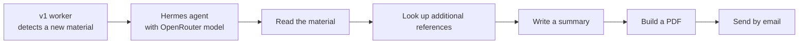
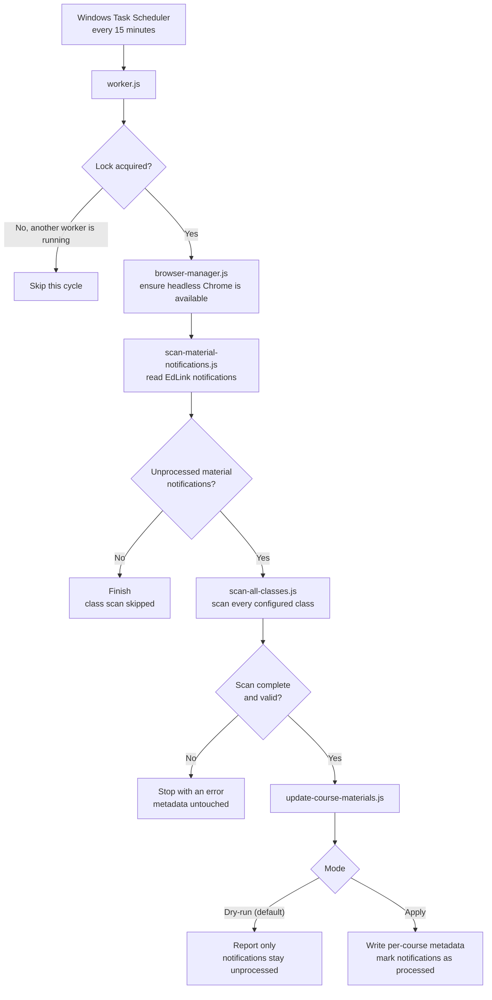
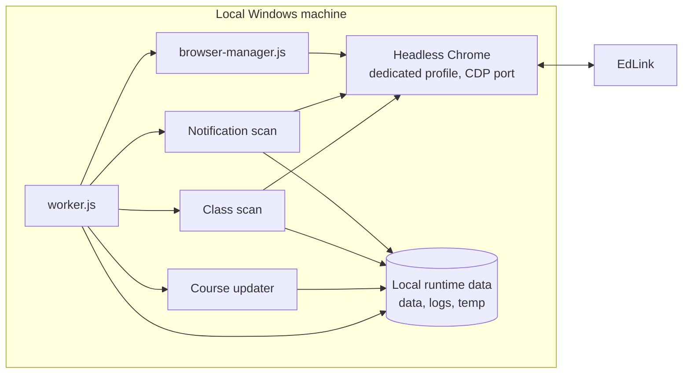

# Hermes-Edlink

Hermes-Edlink is a local worker that watches EdLink for new lecture materials and records them in per-course JSON files. EdLink is the learning management system of Universitas Widyatama.

This repository contains v1, which detects and indexes materials. It does not download attachments or read document contents. Later versions are described in the [roadmap](#roadmap).

## Status

- Current version: v1 (local worker, indexing only).
- The worker runs in apply mode, started every 15 minutes by Windows Task Scheduler.
- End-to-end validation is pending. The worker has run on schedule, but no new material notification has appeared yet. The full path from notification to saved metadata and the processed-notification mark has not been observed on real data.

## Roadmap

| Version | Scope | Runs on | Status |
|---|---|---|---|
| v1 | Detect new materials from EdLink notifications, verify them with a class scan, store metadata and attachment records without duplicates | Local Windows machine | Active, end-to-end validation pending |
| v2 | Integrate the Hermes agent with OpenRouter models. For each new material: read it, look up additional references, write a summary, produce a PDF and send it by email | Local machine | Planned |
| v3 | Full agent that no longer depends on the local device | Not local | Planned |

The scope of v2 and v3 is a working plan and can change. Each version is described in [CHANGELOG.md](CHANGELOG.md), and all versions live in this single repository.

Planned v2 flow:



## How v1 works

### Detection rules

- EdLink notifications matching the pattern `Ada Materi baru @...` are the trigger. They only decide whether to look further.
- The class scanner decides what counts as a material. Only activities labeled `menambahkan materi pada` are included.
- A class scan runs only after a trigger. It verifies the result and is not an independent periodic check. When no new notification appears, the worker finishes without scanning any class.
- Assignments, quizzes, exams, attendance, grades, discussions and other LMS activities are excluded.
- Attachments are not downloaded during normal operation. Only their names and download availability are recorded.

### Worker cycle



If the notification scanner finds a login page, it stops without processing anything and reports that the EdLink session has expired.

### Runtime topology



### Components

| File | Role |
|---|---|
| `scripts/worker.js` | Entry point. Takes the lock, runs the other scripts in order, validates the scan, tracks processed notifications and writes the log. |
| `scripts/browser-manager.js` | Starts headless Chrome with a dedicated profile and a remote debugging port if it is not already running. |
| `scripts/runtime-config.js` | Reads settings from environment variables and provides defaults. |
| `scripts/scan-material-notifications.js` | Connects to Chrome over CDP, checks that the session is logged in and reads material notifications. It does not click or delete notifications. |
| `scripts/scan-all-classes.js` | Opens each configured class and reads material activities, titles, session information and attachment names. |
| `scripts/update-course-materials.js` | Compares scan results with the existing per-course data, using stable IDs to avoid duplicates. Runs as a dry run unless `--apply` is given. Creates a backup before writing. |

## Requirements

- Windows. v1 was developed and operated on Windows. The Node scripts may run elsewhere, but that has not been tested.
- Node.js and npm.
- Google Chrome.
- An EdLink account whose session is already logged in inside a dedicated Chrome profile.
- Local runtime data, described under [Runtime data](#runtime-data).

## Installation

```powershell
npm ci
```

## Configuration

Settings are read from environment variables.

| Variable | Purpose | Default |
|---|---|---|
| `CHROME_PATH` | Chrome executable | `chrome.exe` under Program Files on Windows, `google-chrome` elsewhere |
| `EDLINK_PROFILE_DIR` | Dedicated Chrome profile directory | `temp/edlink-profile` inside the project |
| `CDP_HOST` | Chrome DevTools host | `127.0.0.1` |
| `CDP_PORT` | Chrome DevTools port | `9223` |
| `EDLINK_BASE_URL` | EdLink base URL | `https://lms.widyatama.ac.id` |

## Runtime data

The repository does not contain browser profiles, course data, scan results, logs or generated output. These are created or supplied locally and are excluded by `.gitignore`.

| Path | Content |
|---|---|
| `data/classes.json` | Configured classes. Each entry needs at least `id`, `name` and `url`. |
| `data/courses/<id>-<slug>/` | Per-course `materials.json`, `content-index.json` and `course-info.json`. |
| `data/materials-registry.json` | Legacy registry. The updater requires it to exist but no longer updates it. |
| `data/material-notifications.json` | Latest notification scan result. |
| `data/materials-scan.json` | Latest class scan result. |
| `data/worker-state.json` | Notifications already processed. |
| `data/backups/` | Backups written by the updater before each apply. |
| `logs/worker.log` | Worker log. |
| `temp/worker.lock` | Lock that prevents overlapping runs. |
| `output/reports/` | Generated reports. |

The Chrome profile contains an authenticated session, so treat it like a password. Use a dedicated copy instead of your main profile, keep it outside version control, and do not commit session data, credentials, personal information or private course records.

## Usage

Review the runtime configuration, local data, browser profile and backup strategy before the first run.

The default mode is a dry run for course metadata. It still starts the browser, scans EdLink and can create or update runtime files such as logs, scan results and the lock file, so it is not fully read-only.

```powershell
node scripts/worker.js
```

The `--apply` option writes course metadata and worker state. Use it after reviewing a dry-run report and backing up the local data.

```powershell
node scripts/worker.js --apply
```

Do not run either mode against an active production environment without checking its effects and isolating the runtime data first.

## Scheduling on Windows

v1 was scheduled with a task named `Hermes-Edlink-Worker` using these settings.

| Setting | Value |
|---|---|
| Program | Full path to `node.exe` |
| Arguments | `"<project>\scripts\worker.js" --apply` |
| Start in | The project root |
| Trigger | Repeat every 15 minutes |
| Hidden | Yes |
| If the task is already running | Do not start a new instance (`IgnoreNew`) |
| Missed runs | Start as soon as possible (`StartWhenAvailable`) |
| Execution time limit | 30 minutes |
| Account | The signed-in Windows user |

Daily operation needs the computer to stay on and out of sleep or hibernation, an internet connection, a signed-in Windows account, and the headless Chrome process left running.

## Known limitations

- The worker expects exactly seven classes in `data/classes.json` and stops otherwise. A different number of classes requires editing `scripts/worker.js`.
- The updater only updates course folders that already exist. Creating the initial data for a new class or semester is not part of the worker.
- Notification identity includes the relative time text that EdLink shows. If that text changes between runs, an already handled notification can look new and trigger another class scan. ID matching still prevents duplicate metadata. This is under review.
- Failures, including an expired EdLink session, are written to `logs/worker.log` only. No alert is sent.
- The worker runs on one machine and does not run while that machine sleeps or is off.
- End-to-end validation on a real new-material notification is still pending.

## Project structure

```text
.
├── scripts/       worker, browser manager, scanners and metadata updater
├── experiments/   historical inspection and test scripts
├── archive/       historical backups and one-time maintenance scripts
├── docs/          project documentation
├── CHANGELOG.md
├── LICENSE
├── package.json
└── README.md
```

## Documentation

- [Development history](docs/DEVELOPMENT-HISTORY.md)
- [Changelog](CHANGELOG.md)

## Disclaimer

This is an independent personal project. It is not affiliated with or endorsed by Universitas Widyatama or EdLink. It automates a browser session for an account you are authorized to use. Check your institution's terms of use before running it.

## License

MIT. See [LICENSE](LICENSE).
